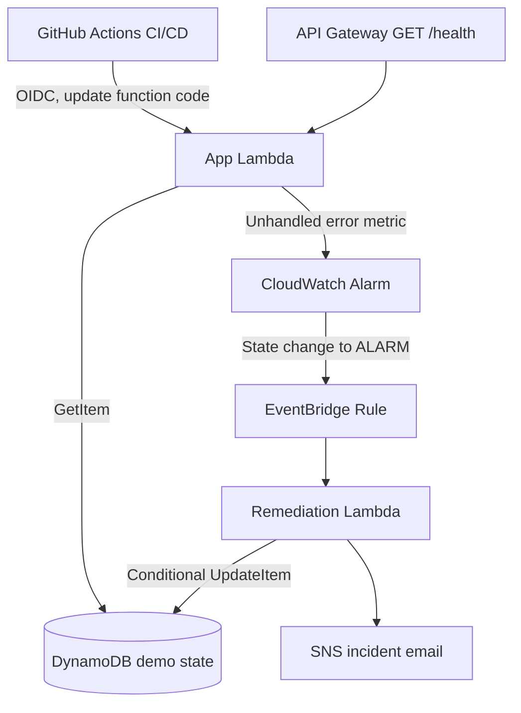

# AWS CloudOps Auto-Healing Platform

**Terraform + AWS Lambda + API Gateway + DynamoDB + CloudWatch + EventBridge + SNS + GitHub Actions OIDC**

A small, cost-aware AWS operational automation project for CloudOps / DevOps / SRE interviews. It demonstrates a **controlled application fault** detected by native Lambda telemetry, followed by **event-driven state remediation**. It does *not* reboot actual instances or recover physical infrastructure.

## Architecture



## Security and cost decisions

- No EC2, EKS, NAT gateway, load balancer, VPC endpoints, RDS or always-on worker.
- One low-capacity provisioned DynamoDB table, two 128-MB Lambdas with concurrency capped at 2, one CloudWatch alarm, one EventBridge rule and a small SNS topic.
- **Public endpoint supports only `GET /health`**; failure injection requires authenticated AWS CLI permissions. API rate-limited at the gateway.
- Application IAM policy allows only `dynamodb:GetItem`; remediation policy allows only `dynamodb:UpdateItem` and `sns:Publish` for the specific resources.
- GitHub deploy role can only update code for the project's two Lambda functions and trusts the exact main-branch GitHub OIDC subject (including immutable owner/repository IDs).
- Lambda log retention is three days. Public APIs can still receive traffic and costs can arise on some plans; always check credits/billing and destroy unused resources.
- Terraform state is local in AWS CloudShell and ignored by Git. Keep CloudShell `$HOME` data safe; do not delete `.tfstate` or commit it.

## Prerequisites

1. AWS console with CloudShell access and permissions to create Lambda, API Gateway, DynamoDB, CloudWatch, EventBridge, SNS and IAM resources.
2. AWS region chosen, preferably the region from your AWS project.
3. Optional: email for SNS alerts; later confirm the subscription email.
4. Optional: a **public GitHub repository** for CI/CD.

## 1. Download and deploy from AWS CloudShell

In AWS Console click the **CloudShell (`>_`)** icon. Use **Actions → Upload file** to upload `aws-cloudops-auto-healing-platform.zip` from your laptop. Then:

```bash
unzip -oq aws-cloudops-auto-healing-platform.zip
cd aws-cloudops-auto-healing-platform
bash scripts/install-terraform.sh
export PATH="$HOME/.local/bin:$PATH"
aws sts get-caller-identity
aws configure get region
```

Choose the project region, if needed (example Mumbai):

```bash
export TF_VAR_aws_region="${AWS_REGION:-${AWS_DEFAULT_REGION:-ap-south-1}}"
```

Add an alert email **optionally**:

```bash
export TF_VAR_notification_email="your-email@example.com"
```

To avoid accidentally routing alerts to someone else's inbox, set the variable to your own email only. Omit this line if you don't want email alerts yet.

```bash
cd infra
terraform init
terraform validate
terraform plan
terraform apply
terraform output
curl -i "$(terraform output -raw health_url)"
```

Type `yes` to approve the plan. Terraform might fail if AWS Free plan restricts a specific service or if your identity lacks IAM permissions; do not upgrade to a Paid plan just to get around a restriction.

## 2. Demonstrate the auto-healing sequence

From the repo root:

```bash
cd ..
bash scripts/demo.sh
```

The script displays a successful health check, changes DynamoDB `status` to `FAILED` with the authenticated AWS CLI and sends exactly one failed health request. Watch the metric alarm and EventBridge recovery in AWS Console. Detection typically occurs after CloudWatch metric evaluation, so it is not instantaneous.

```bash
cd infra
aws cloudwatch describe-alarms \
  --alarm-names "$(terraform output -raw alarm_name)" \
  --query 'MetricAlarms[0].{State:StateValue,Updated:StateUpdatedTimestamp}'

aws logs tail /aws/lambda/cloudops-demo-remediate --since 15m
curl -i "$(terraform output -raw health_url)"
```

Expected final response: `200` with JSON containing `"status": "healthy"`. On the console, capture: a failing API response, CloudWatch ALARM history, EventBridge invocation / recovery Lambda logs, successful API response, and SNS email if subscribed.

If the CloudWatch alarm was already in ALARM from a previous attempt, it may not emit another *state-change* event. Reset the state, wait until CloudWatch shows OK, then rerun the demo.

To manually reset:

```bash
cd ..
bash scripts/reset.sh
```

## 3. Wire GitHub Actions CI/CD (optional final phase)

**Create a NEW public GitHub repo called** `aws-cloudops-auto-healing-platform` **with no README** (we already have one). In CloudShell, from repo root, configure exact OIDC trust using GitHub's public API:

```bash
bash scripts/configure-github.sh YOUR_GITHUB_USERNAME/aws-cloudops-auto-healing-platform
cd infra
terraform apply
terraform output -raw github_role_arn
terraform output -raw health_url
```

This handles GitHub repos created after **2026-07-15**, whose OIDC `sub` embeds immutable account/repo IDs.

In GitHub repo → Settings → Secrets and variables → Actions → **Variables** → New repository variable, configure:

- `AWS_REGION`: same region used in Terraform (e.g. `ap-south-1`)
- `AWS_ROLE_ARN`: output of `terraform output -raw github_role_arn`

Then push source code. **Never push `terraform.tfstate`, `*.tfvars.json`, credentials, or ZIPs.**

```bash
cd ..
git init
 git branch -M main
 git add .
 git commit -m "Add Terraform-managed AWS auto-healing demo"
 git remote add origin https://github.com/YOUR_GITHUB_USERNAME/aws-cloudops-auto-healing-platform.git
 git push -u origin main
```

CloudShell's HTTPS git push requires a GitHub personal access token (not a GitHub password), or you can upload the unzipped project files using GitHub Desktop on your laptop. A GitHub credential must **never** be committed to the repo. For easier authentication in a browser, GitHub's CLI `gh auth login` is another route if installed.

GitHub Actions will run unit tests then update both function ZIPs using short-lived OIDC credentials. Only the `main` branch can assume the AWS role.

**Important:** Do not run the new `deploy.yml` before Terraform has created its GitHub OIDC role and you've set the two GitHub repository variables.

## 4. Run tests

```bash
python3 -m unittest discover -s tests -v
```

The tests don't need AWS credentials, and boto3 is mocked.

## 5. Destroy to avoid continuing charges

In the same CloudShell region and with the same Terraform state:

```bash
cd infra
terraform destroy
```

**After using CI/CD:** Terraform may not track code changes made by GitHub Actions (code changes are intentionally ignored to keep Terraform from overwriting them). `terraform destroy` still removes the managed resources.

## Troubleshooting

| Symptom | Check |
|---|---|
| `terraform: command not found` | Run `bash scripts/install-terraform.sh` and `export PATH="$HOME/.local/bin:$PATH"`. |
| `AccessDenied` for IAM/Lambda | Verify current project/account and your IAM permissions; Free plan restrictions may apply. |
| `curl /health` gives 404 | Copy the **Terraform health_url output**, including `/health`. |
| `curl` gives 5xx before injection | Inspect `aws logs tail /aws/lambda/cloudops-demo-app --since 10m`; verify DynamoDB table initial item, IAM GetItem and function environment. |
| No remediation | Check `aws cloudwatch describe-alarms`, EventBridge rule status, and remediation Lambda CloudWatch logs. Alarm needs a transition to ALARM. |
| No alert email | Check SNS subscription confirmation email; use SNS console to check pending subscriptions. |
| GitHub OIDC AccessDenied | Check exact `sub` including owner/repo numeric IDs, branch `main`, repository Variables and role ARN. |
| CloudShell storage lost | Restore the **original Terraform state** before managing previously created resources; do not blindly apply a new state or duplicate resources. |

## Interview talking points

**Problem:** An app can enter a failed state; relying solely on on-call staff is slow.

**Solution:** Terraform provisions an event-driven system; CloudWatch detects errors; EventBridge invokes a least-privilege recovery Lambda; DynamoDB transitions back to healthy; SNS notifies an operator; GitHub Actions rolls out code securely with OIDC.

**Operational insight:** Auto-healing here is *application-state remediation*, not real server repair. Tradeoffs include alarm evaluation delay, idempotence and conditional writes, notification delivery, exposure of public health endpoints, lack of guaranteed exactly-once delivery, and tracking Terraform state separately from CI code updates.

**Resume bullet:** Built a Terraform-managed AWS application auto-healing demo with Lambda, API Gateway, DynamoDB, CloudWatch alarms, EventBridge, SNS and GitHub Actions OIDC, validating fault injection, recovery, alerting and secure CI/CD.
